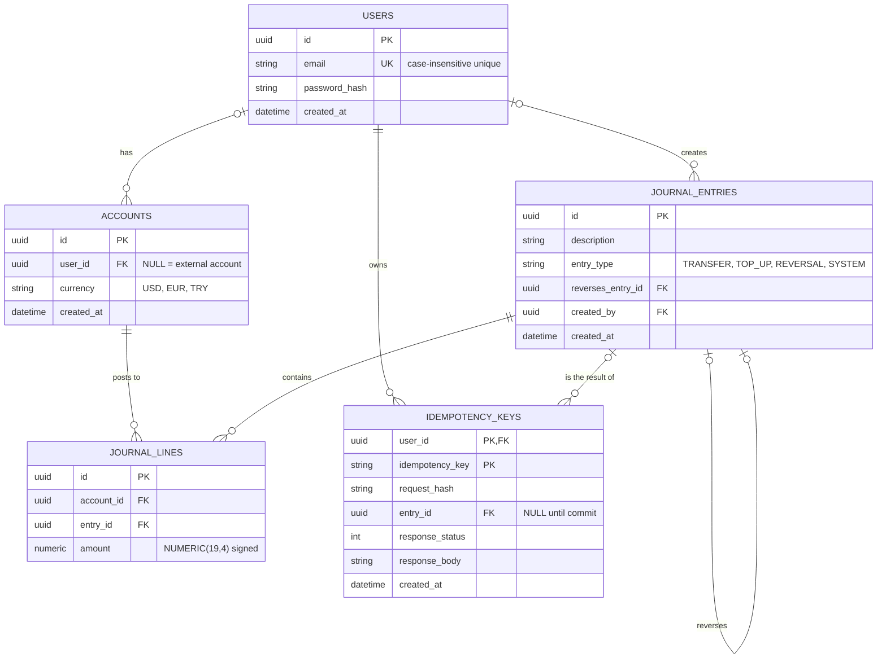

# Wallet & Ledger

A multi-currency wallet (EUR, USD, TRY) backed by a double-entry ledger. All money is fake. This is a portfolio project
that tackles the problems real payment systems face.

> **Status:** early development. The database schema, ledger domain model (including a Money value type), persistence
> stores, posting service and CI are in place. On the frontend: theme, sign-in and sign-up screens, routing, and a
> dashboard with balance cards on mock data. The API and the rest of the screens are next.

## Goals

- **No duplicate payments:** every transfer carries an idempotency key. *(planned)*
- **Correct under concurrency:** accounts are locked in a fixed order and tested with parallel transfers. *(planned)*
- **Auditable books:** entries are append-only, and every entry balances to zero. *(done)*
- **Reliable events:** a transactional outbox publishes to Kafka. *(planned)*
- **Protected endpoints:** Redis rate limiting with a documented fail-open/closed decision. *(planned)*

## Tech stack

| Area     | Technology                                                                                              |
|----------|---------------------------------------------------------------------------------------------------------|
| Backend  | Java 21, Spring Boot 3.5, Maven                                                                         |
| Database | PostgreSQL 16, Flyway migrations                                                                        |
| Tests    | JUnit 5, AssertJ, Mockito, Testcontainers, ArchUnit                                                     |
| Frontend | React, TypeScript, Vite, Tailwind CSS v4, shadcn/ui, TanStack Query, React Router, React Hook Form, Zod |
| CI       | GitHub Actions: backend tests, frontend lint and build; Dependabot for dependency updates               |
| Planned  | Kafka, Redis, Docker (full stack), AWS (Terraform)                                                      |

## Repository layout

```
.
├── backend/walletledger/    Spring Boot application
│   └── src/main/resources/db/migration/   Flyway migrations (V1 users, V2 ledger, V3 one line per account per entry,
        V4 unique email and V5 entry types and idempotency_keys)
├── frontend/                React + TypeScript single-page app (Vite)
├── docs/adr/                Architecture decision records
├── docs/conventions/        Coding, testing and Git conventions
├── .github/                 CI workflow, Dependabot, pull request template
├── docker-compose.yml       Local PostgreSQL
└── .env.example             Database settings for Docker Compose
```

## Run it locally

Requirements: Java 21, Docker.

```bash
# 1. Configure the database (optional: defaults are used if you skip this)
cp .env.example .env

# 2. Start PostgreSQL (host port 5433)
docker compose up -d postgres

# 3. Run the tests (Testcontainers starts its own throwaway database)
cd backend/walletledger
./mvnw test

# 4. Run the application (Flyway applies the migrations to the Compose database)
./mvnw spring-boot:run

# 5. Run the frontend (separate terminal)
cd frontend
npm ci
npm run dev
```

Note: `.env` is read by Docker Compose only. Spring Boot reads operating system environment variables and
`application.yml`.

## Ledger design

The ledger follows double-entry bookkeeping. The main rules:

- **Entries and lines.** A journal entry has at least two lines. Each line posts a signed `NUMERIC(19,4)` amount to one
  account.
- **Entry types.** Each entry has a type (`TRANSFER`, `TOP_UP`, `REVERSAL`, `SYSTEM`) and an optional creator.
A `REVERSAL` points to the entry it reverses, and an entry can be reversed at most once.
- **Signed amounts.** A positive amount increases the account's balance and a negative amount decreases it. An entry is
  balanced when its lines sum to zero (per currency).
- **Balances are derived.** An account's balance is the sum of its lines. Any stored balance is only a cache.
- **Append-only.** Lines are never updated or deleted. A correction is a new, reversing entry.
- **Currency lives on the account.** A line cannot be in a different currency from its account.
- **Accounts.** One account per user and currency. Money entering the system (top-ups) comes from one external account
  per currency.
- **One line per account per entry.** An account appears at most once in an entry (checked in the domain model and by
  a unique constraint).
- **Amount limits.** Domain: at most the currency's minor units as decimals (2 for EUR, USD and TRY) and 15 integer
  digits. The column is `NUMERIC(19,4)` (ADR 4). Too many decimals are rejected, never rounded silently.
- **Rules in the database:** primary and foreign keys, the allowed currency list, non-zero amounts, and the
  uniqueness rules. The rule that an entry's lines sum to zero spans several rows, so it is enforced when a
  `LedgerEntry` is created; the posting service saves entries in one transaction.



## Design decisions

Decisions are recorded as architecture decision records in [`docs/adr`](docs/adr):

- [0001: Double-entry ledger](docs/adr/0001-double-entry-ledger.md)
- [0002: Idempotent transfers](docs/adr/0002-idempotency.md) (proposed)
- 0003: locking strategy (reserved)
- [0004: Money type and rounding](docs/adr/0004-money-type-and-rounding.md) (proposed)

Coding, testing and Git conventions are in [`docs/conventions`](docs/conventions).

## Testing

Database tests use Testcontainers, so they need Docker but no local database setup. The suite covers:

- schema constraints (duplicate accounts, unknown currencies, zero amounts, missing foreign keys)
- domain rules in `LedgerEntry` and `LedgerLine` (plain unit tests, no database)
- entities, repositories and stores, including a rollback test for failed saves
- posting service rules: unbalanced entries, unknown accounts and rollback (unit and integration tests)
- an ArchUnit rule that keeps entities inside `ledger.persistence`

CI also lints and builds the frontend on every pull request.

## Roadmap

1. ~~Ledger core: domain model, stores~~
2. ~~Posting service~~
3. Idempotent transfers, locking, rounding rules
4. Spring Security + JWT, OpenAPI spec
5. React + TypeScript frontend (scaffold, theme and auth screens done)
6. Docker Compose for the full stack, Redis rate limiter, Kafka outbox
7. AWS deployment with Terraform, demo account

## License

See [LICENSE](LICENSE).
